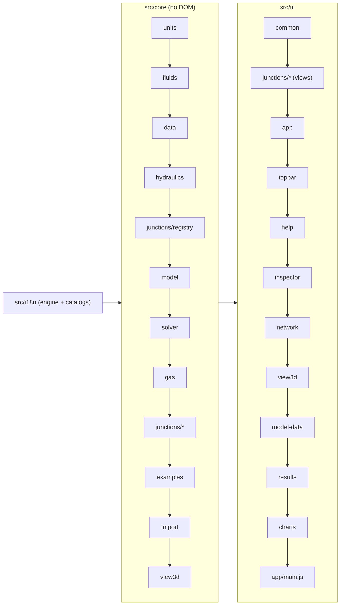

# Architecture

Pump It is a static web app: plain HTML, CSS and JavaScript with no build step and no dependencies, so `index.html` opens straight from disk. The code is organised in **blocks** (folders) with small files, so that different people can work on different blocks at the same time without editing the same files.

## Principles

- **One global namespace.** Every file is a classic script wrapped in an IIFE that attaches its module to `PumpIt` (core) or `PumpIt.ui` (interface). The application controller is `PumpIt.app`.
- **`index.html` is the manifest.** It lists every script and stylesheet in load order, grouped by block. The Node tests read the core part of that list (`tests/load-core.js`), so a new core file only has to be added there.
- **The core has no DOM.** Everything under `src/core/` runs in Node and in the browser. Values are SI inside the core; units are converted only at input and output.
- **Registries instead of switches.** Junction types, fluids, examples, pipe catalogues and file importers register themselves. Generic code never tests for a specific junction type or pipe material: it reads the type's definition (core) or view (interface), or the catalogue's definition.
- **No text in the code.** Everything the user reads comes from the message catalogs (`src/i18n/<language>/`), by key; the code, its comments and the keys are in English.

## Blocks and load order



| Block | Folder | Namespace | Content |
| --- | --- | --- | --- |
| Languages | `src/i18n/` | `PumpIt.i18n` | Message catalogs per language and block, `t(key, params)`, current language, number locale |
| Units | `src/core/units.js` | `PumpIt.units` | Unit categories, conversion to and from SI, unit labels |
| Fluids | `src/core/fluids/` | `PumpIt.fluids` | Fluid library (`register`, `evaluate`); water from public correlations; the gases of the compressible mode (`GASES`, `evaluateGas`, Sutherland, normal density) |
| Engineering data | `src/core/data/` | `PumpIt.data` | Pipe catalogues (carbon and stainless steel, HDPE, ductile iron), one file each, registered in `pipe-library.js` (`registerPipes`, `pipeDims`, `fitMaterial`; see [pipe-library.md](pipe-library.md)), roughness, fittings (Crane), water velocity bands |
| Hydraulics | `src/core/hydraulics/` | `PumpIt.hyd` | Friction factors, curve fitting, local loss coefficients |
| Model | `src/core/model/` | `PumpIt.model` | Factories (`newModel`, `newPipe`, `newJunction`, `pipeDefaults`), scenarios, checklist (`validate`), drawing-only fields (`LAYOUT_KEYS`, `stripLayout`, `normalizeLayout`), the ends of pipes (`connectEnd`, `loosenEnd`, `spotNear`, `normalizeEnds`: an end may be loose, see [pipe-ends.md](pipe-ends.md)) |
| Solver | `src/core/solver/` | `PumpIt.solver` | `run`, `prepare`, `systemCurve` and the internal stages |
| Compressible mode | `src/core/gas/` | `PumpIt.gas` | The reference physics of gas flow (`gas.js`, appendix A of its specification), the flow relations of the links (`flow.js`), the gas network of a model (`network.js`), Newton on the node pressures (`newton.js`), results (`results.js`) and `solveModelGas` (`solver.js`); see [gas-decisions.md](gas-decisions.md) |
| Junction types | `src/core/junctions/` | `PumpIt.junctionTypes` | Registry and one file per type |
| Examples | `src/core/examples/` | `PumpIt.examples` | Builder helpers and one file per example |
| Import | `src/core/import/` | `PumpIt.importers`, `PumpIt.importShared` | Readers of model files of other formats, one per file extension: `.fth` for liquids and `.aro` for gases (the format descriptions of the specification team; docs/fth-import.md, docs/aro-import.md) → the scenarios of the file, a model of one of them, the notes of the import (what needs input, was assumed, left out or read) and the comparison with the results stored in the file. What the two formats share (sections, records, scenarios, units, notes, drawing positions, comparison) is `shared.js` |
| 3D view geometry | `src/core/view3d/` | `PumpIt.view3d` | Camera and projection, navigation, the grid, pipe routes that follow their ends, symbol orientation, scene points from the plan and the elevation, editing, the junction symbols as solids, the view cube (pure functions; see [3D-VIEWS.md](3D-VIEWS.md)) |
| Common UI | `src/ui/common/` | `PumpIt.ui.format`, `.pipeLabels`, `.dom`, `.dialogs`, `.tips`, `.download`, `.xlsx` | Formatting, the designations of catalogue pipes, DOM helpers, dialogs, the bubble of the notes (the "i" of the fields), downloads, .xlsx writer |
| Junction views | `src/ui/junctions/` | `PumpIt.ui.junctionTypes` | Registry and one view per type |
| Application | `src/ui/app/` | `PumpIt.app` | State, selection, editing and undo, clipboard, calculation, files (open `.json`, or another format through the importer of its extension; files dropped on the window), the import report, layout, keyboard, start-up |
| Top bar | `src/ui/topbar/` | `PumpIt.ui.menus`, `.shortcuts`, `.header`, `.scenarios`, `.checklist`, `.language`, `.theme` | Menus and commands (the Options menu adds its own, `options.js`), keyboard shortcuts box, header status and the stamp of the regime, scenarios, checklist, language selector, light and dark mode button |
| Help | `src/ui/help/` | `PumpIt.ui.help`, `.tour`, `.helpEquations` | The help window (chapters, search, links that light areas of the screen), the guided tour and the formulas of the technical reference |
| Inspector | `src/ui/inspector/` | `PumpIt.ui.inspector`, `.forms`, `.systemForm`, `.systemWindow`, ... | Field builders (with their notes), one file per panel, the drawing of a reservoir (`.reservoirDrawing`: the tank cut through, with the elevations of its fields), the opening and collapsing of the panel, which follows the selection (and its arrow), and the system window: the properties of the system in a window over the page, with a summary in the panel when nothing is selected |
| Network view | `src/ui/network/` | `PumpIt.ui.canvas`, `.drawing`, `.colorScales`, `.palette`, `.infoCard` | Interaction, SVG drawing, colour scales, palette (with the arrow that collapses it), right-click card |
| 3D view | `src/ui/view3d/` | `PumpIt.ui.scene3d`, `.commands3d`, `.edit3d` (with `.freeEdit3d`), `.solids3d`, `.render3d`, `.quick3d`, `.nav3d`, `.hud3d`, `.cube3d` | Scene (plan and elevation), commands, editing, the junction symbols as shaded solids, SVG drawing with depth cues and quick frames while something moves, camera navigation and glides, view switch with the menu of the view, the view cube, inspector sections (see [3D-VIEWS.md](3D-VIEWS.md)) |
| Model data view | `src/ui/model-data/` | `PumpIt.ui.modelData` | Input tables |
| Results view | `src/ui/results/` | `PumpIt.ui.results`, `.resultCatalog`, `.columnSetup`, `.resultColumns`, `.columnWindow`, `.resultExport` | The outputs each table can show (no DOM), the columns chosen for a liquid and for a gas with their units and the templates of the profile, result tables, the column window, warnings, TSV and Excel export (a sheet per table); see [result-outputs.md](result-outputs.md) |
| Charts view | `src/ui/charts/` | `PumpIt.ui.charts`, `.lineChart`, `.pumpChart`, `.profileChart` | Charts |
| Styles | `src/ui/styles/` | — | One stylesheet per block, in cascade order |

Load-order rules: a file may use, **at load time**, only modules listed before it in `index.html`; anything used later (inside functions) only needs to exist by the time it is called. `src/ui/app/main.js` is always last: it binds every block to the page on `DOMContentLoaded`. The one script out of its group is `src/ui/topbar/theme.js`, loaded before the page body so that a light or dark mode chosen earlier is set (as `data-theme` on `<html>`, read by `tokens.css`) before the first paint; at load time it uses only the browser.

## Data flow

1. **Edit.** A panel calls `app.setVal(key, path, value)` (or another command in `src/ui/app/editing.js`). The command pushes an undo snapshot and writes through `PumpIt.model.setField`, which applies the scenario rule: the base scenario holds every value, a child scenario stores only the attributes that differ from its parent.
2. **Recalculate.** `app.changed()` increments `app.version`, clears every result, saves the model to the browser and calls `app.recalc()`: if the checklist (`PumpIt.model.validate`) of the current scenario is complete, `PumpIt.solver.run(app.eff())` calculates it.
3. **Render.** `app.renderAll()` redraws the header, the drawing, the inspector, the system window (when open) and the visible view. Panels read `app.eff()` (effective model of the current scenario) and `app.okResults()`.

Drawing fields (`PumpIt.model.LAYOUT_KEYS`: the schematic position, symbol rolls, pipe routes, where the loose ends of pipes lie and the 3D view settings) are not calculation data. They live on the objects of the base model, never in scenario overrides; editing them only pushes an undo snapshot and saves, without recalculating or clearing the results; and the solver works on a copy without them. The 3D views draw every junction at its schematic position and at the height of its elevation, which is calculation data: moving a junction up or down there is an elevation edit, with recalculation.

## Interface languages

`src/i18n/i18n.js` holds the messages of every language and answers `PumpIt.i18n.t(key, params)` in the current one. Each language is a folder with one catalog per block of the app:

```
src/i18n/en/      language.js  core.js  junctions.js  examples.js  app.js  network.js  inspector.js  model-data.js  results.js  charts.js  help.js
src/i18n/pt-BR/   (same files)
src/i18n/es/      (same files)
```

- **Keys** are dotted paths that start with the block: `app.menu.file`, `junctions.pump.form.speed`, `core.solver.notConverged`. Texts may hold `{name}` placeholders, filled by `t(key, { name })`. A text may contain simple HTML (`<sub>`, `<b>`); values put into it are escaped by the caller.
- **English (`en`) is the base language.** Every key must exist there; a key missing in another language falls back to the English text (and `tests/check-i18n.js` fails). It is also the language of a browser whose own language is not supported, and the language of the texts written in `index.html` before `src/ui/topbar/language.js` applies the current one.
- **Static page texts** in `index.html` carry `data-i18n="key"` (element text) or `data-i18n-title`, `-aria-label`, `-placeholder`, `-content` (attributes); `src/ui/topbar/language.js` applies them.
- **The core uses the same catalogs** for what it produces (checklist items, warnings, valve states, example models). Results therefore come out in the current language, and a language change recalculates.
- **Numbers** are formatted with the number locale of the language (`PumpIt.ui.format`); unit symbols are shown through `PumpIt.units.label` (catalog `core.units.label`).
- Junction type names come from `junctions.<type>.label`, example names from `examples.<id>.name`; fluids, fittings and roughness presets read their names from `core.*` by id.

Changing the language (`app.setLanguage`, in `src/ui/topbar/language.js`): switch the catalog, save the preference, apply the page texts, rebuild the examples menu and the palette, rebuild an untouched example, clear the results, recalculate and redraw.

## Solver pipeline

`PumpIt.solver.run(eff)` (`src/core/solver/solver.js`) first takes a copy of `eff` without the drawing fields (`PumpIt.model.stripLayout`). A model in the compressible regime (`system.regime === 'compressible'`) goes to `PumpIt.gas.solveModelGas` (below); otherwise:

1. `prepare` (`network.js`): fluid properties, pipes in SI, nodes and links. Single-node junction types create their node through `buildNode`; two-port types become an element link filled by `buildElement`.
2. Device loop, until the device states settle: `configure` (`devices.js`) → `analyze` (`connectivity.js`, pressure references and isolated parts) → `newton` (`newton.js`, link mass flows and node pressures solved together) → `review` (`devices.js`).
3. `postprocess` (`results.js`): pipe, junction, pump and valve results and the warnings; type-specific results come from `nodeResults` / `elementResults`.

### Compressible mode

`PumpIt.gas.solveModelGas(eff)` (`src/core/gas/solver.js`) follows the same pipeline with its own stages:

1. `prepare` (`network.js`): the gas and its context (thermal model, gravity), pipes in SI (`PumpIt.solver.pipeData`, shared with the liquid), nodes and links built by the `gas` hooks of the junction types. A node carries the kind of its pressure (static or stagnation); a link carries a relation (a duct, a nozzle, a curve) or a row of its own (`con`: a set pressure, a ratio, a tie, a flow given as a volume).
2. Device loop, reusing `configure`, `analyze` and `review` of the solver: Newton on the free node pressures (`newton.js`), where every ordinary link gives its mass flow from its two nodes (`flow.js`: inlet state, closed isothermal form, march, Fanno, choking, the inverse problem and its derivatives). The adiabatic model wraps the Newton in the loop of the node temperatures and starts from the isothermal solution. The first pressures come from the linear theory of gas networks on P².
3. `postprocess` (`results.js`): the results of a gas in the shape of the liquid ones, with the fields of a gas, and the warnings; type-specific results come from `gas.results`.

## Extension points

### A new junction type

1. `src/core/junctions/<type>.js`: `PumpIt.junctionTypes.register({ ... })` following the contract at the top of `src/core/junctions/registry.js` (defaults, checklist, network equations, results, and the `gas` hooks of the compressible mode — without them the type is refused in that mode).
2. `src/ui/junctions/<type>.js`: `PumpIt.ui.junctionTypes.register('<type>', { ... })` following the contract at the top of `src/ui/junctions/registry.js` (symbol, the solid of the 3D views, inspector form, summaries, result rows).
3. Its texts under `junctions.<type>` in `src/i18n/<language>/junctions.js` of every language (at least `label`).
4. Add both `<script>` tags to their groups in `index.html`.

The palette, the type selector, the checklist, the solver, the tables, the right-click card and the drawing pick the new type up from the registries.

### A new language

1. Copy `src/i18n/en/` to `src/i18n/<code>/` (for example `fr`) and translate the texts, keeping keys and `{placeholders}`.
2. In `language.js`, register the language with its own name and number locale: `PumpIt.i18n.register('fr', { name: 'Français', numberLocale: 'fr-FR' })`.
3. Add the `<script>` tags of the folder to the "Languages" group of `index.html`, in the same order as the other languages.
4. Run `npm test`: `tests/check-i18n.js` lists any missing or extra key and any placeholder mismatch.

The selector in the top bar lists the new language automatically.

### New texts

Never write a user-facing text in the code: add a key to the block's catalog in **every** language folder (en first) and call `t('block.key', params)`. For a text in `index.html`, add a `data-i18n` attribute. `npm test` checks that every key used literally in the code exists.

### A new fluid

Add `src/core/fluids/<fluid>.js` calling `PumpIt.fluids.register(kind, { label, range, sources, rho, mu, pv })` (functions of the temperature in °C, SI results; `label` and `sources` as getters reading the catalogs, like `water.js`), its texts in every language under `core.fluids.<kind>`, and its `<script>` tag after `fluids.js`. The fluid selector and the checklist list library fluids automatically. Use public correlations only.

### A new pipe catalogue

Add `src/core/data/<material>-pipe.js` with the table of its standard, calling `PumpIt.data.registerPipes(kind, { ... })` following the contract at the top of `src/core/data/pipe-library.js` (sizes, series, dimensions, the decimals of the standard, roughness, the kinds of nominal size and of series, grades, defaults), and its `<script>` tag after `pipe-library.js`. Its texts go under `core.data.pipes.materials.<kind>` and `inspector.pipe.materials.<kind>` in every language; a new kind of nominal size, series or grade also needs its designations (`core.data.pipes.size`, `.nominal`, `.series`, `.grades`) and field labels (`inspector.pipe.sizes`, `.series`). The material list, the pipe panel, the designations of the tables and cards, and the change of material pick it up; `npm test` checks its tables and its texts. Cite the standard and the roughness in [pipe-library.md](pipe-library.md) and the README.

### A new import format

Add `src/core/import/<ext>.js` registering `PumpIt.importers.<ext>` (the file extension, in lower case) with `encoding`, `read(text, { name, scenario })` → `{ model, notes, counts, stored }`, `compare(results, stored)`, `noteText(note)` and `LEVELS`, as `fth.js` does, and its `<script>` tag. An importer of a format with scenarios also gives `scenarios(text)` → `[{ n, name, path, description, results }]`: with more than one, the app asks which one to read. File → Open, the file input and file drops choose the importer by the extension, and the import report shows what it read. Its texts go in every language; list the extension in `app.menu.open`. A format of the same family as `.fth` and `.aro` (sections with positional records, scenarios kept as differences) builds on `shared.js` (`PumpIt.importShared`).

### A new example

Add `src/core/examples/<name>.js` calling `PumpIt.examples.register({ id, order, build })`, using the helpers in `PumpIt.examples.builder`, its texts under `examples.<id>` in every language (`name`, `title` and the object names), and its `<script>` tag.

### Result columns, charts and panels

- Result outputs: an entry in `CATALOG` of `src/ui/results/catalog.js` (field or value function, group, unit category) and its header under `results.columns` (liquid) or `results.gasColumns` (gas) in every language. The column window lists it at once; `DEFAULTS` says which outputs a table shows before the user chooses. A value the results of the core do not have is worked out by the entry's `v(row, ctx)`.
- Charts: a new file in `src/ui/charts/`, an entry in `CHARTS` (`charts.js`) and a tab button in `index.html`.
- Inspector panels: `PumpIt.ui.inspector.panels.<name>(host, ...)`, dispatched by `src/ui/inspector/inspector.js`. Another block adds a section after a panel with `PumpIt.ui.inspector.addSection('system' | 'pipe' | 'junction', fn)`, as the 3D views do.
- Notes of a field or a section (an "i" that shows the text on hover or focus): `info` in the options of the field builders and of `section()` in `src/ui/inspector/forms.js`, or `forms.note(section, html)`. `forms.hint()` is for a line that must stay in sight: a state (an isolated pipe, the fitted curve) or an error.
- Network drawing: in the 3D view, `src/ui/network/canvas.js` hands its pointer events and its drawing over to `src/ui/view3d/`; the schematic keeps its own code.

## Tests

- `tests/run-tests.js` (also run by `tests/motor.test.cjs`): the core against independent solutions (analytical or by bisection).
- `tests/gas.test.cjs`: the reference physics of the compressible mode (appendix B of its specification, as given) and the calculation of gas networks against independent solutions.
- `tests/validate-fth.js`: the core against results stored in reference model files (answer key only; see the clean-room rules in `CONTRIBUTING.md`).
- `tests/fth-import.test.cjs`: the `.fth` importer, with synthetic files written from the format descriptions by the test itself.
- `tests/aro-import.test.cjs`: the `.aro` importer, in the same way.
- `tests/check-i18n.js`: same keys and placeholders in every language, every literal key of the code defined, the texts of every pipe catalogue, every example calculated in every language without missing texts, and every reference inside the help (labels, links, formulas, examples, areas of the screen, tour steps) resolved.
- `tests/view3d.test.cjs`: the geometry of the 3D view and of the view cube against exact values, and the drawing/calculation contract (every example gives byte-identical results with a random drawing).
- `tests/pipe-ends.test.cjs`: freeing and connecting the ends of pipes, where a loose end goes, the checklist and both solvers with a loose end, and loaded models whose ends point nowhere.
- `tests/result-columns.test.cjs`: every result output on every example, the formulas of the derived outputs against the core, the best efficiency point, the default columns, the columns kept in the preferences (units, templates, profile file) and the `.xlsx` file with a sheet per table. It loads `catalog.js`, `column-setup.js` and `xlsx.js` with the core, since they need no DOM.
- All of them load the core with `tests/load-core.js`, from the list in `index.html`.
