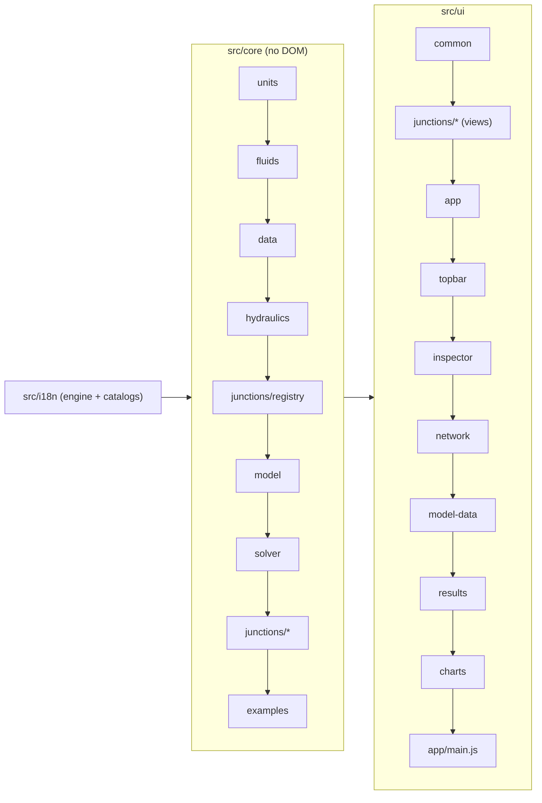

# Architecture

Pump It is a static web app: plain HTML, CSS and JavaScript with no build step and no dependencies, so `index.html` opens straight from disk. The code is organised in **blocks** (folders) with small files, so that different people can work on different blocks at the same time without editing the same files.

## Principles

- **One global namespace.** Every file is a classic script wrapped in an IIFE that attaches its module to `PumpIt` (core) or `PumpIt.ui` (interface). The application controller is `PumpIt.app`.
- **`index.html` is the manifest.** It lists every script and stylesheet in load order, grouped by block. The Node tests read the core part of that list (`tests/load-core.js`), so a new core file only has to be added there.
- **The core has no DOM.** Everything under `src/core/` runs in Node and in the browser. Values are SI inside the core; units are converted only at input and output.
- **Registries instead of switches.** Junction types, fluids and examples register themselves. Generic code never tests for a specific junction type: it reads the type's definition (core) or view (interface).
- **No text in the code.** Everything the user reads comes from the message catalogs (`src/i18n/<language>/`), by key; the code, its comments and the keys are in English.

## Blocks and load order



| Block | Folder | Namespace | Content |
| --- | --- | --- | --- |
| Languages | `src/i18n/` | `PumpIt.i18n` | Message catalogs per language and block, `t(key, params)`, current language, number locale |
| Units | `src/core/units.js` | `PumpIt.units` | Unit categories, conversion to and from SI, unit labels |
| Fluids | `src/core/fluids/` | `PumpIt.fluids` | Fluid library (`register`, `evaluate`); water from public correlations |
| Engineering data | `src/core/data/` | `PumpIt.data` | Steel pipe (ASME B36.10M), roughness, fittings (Crane), water velocity bands |
| Hydraulics | `src/core/hydraulics/` | `PumpIt.hyd` | Friction factors, curve fitting, local loss coefficients |
| Model | `src/core/model/` | `PumpIt.model` | Factories (`newModel`, `newPipe`, `newJunction`), scenarios, checklist (`validate`) |
| Solver | `src/core/solver/` | `PumpIt.solver` | `run`, `prepare`, `systemCurve` and the internal stages |
| Junction types | `src/core/junctions/` | `PumpIt.junctionTypes` | Registry and one file per type |
| Examples | `src/core/examples/` | `PumpIt.examples` | Builder helpers and one file per example |
| Common UI | `src/ui/common/` | `PumpIt.ui.format`, `.dom`, `.dialogs`, `.download`, `.xlsx` | Formatting, DOM helpers, dialogs, downloads, .xlsx writer |
| Junction views | `src/ui/junctions/` | `PumpIt.ui.junctionTypes` | Registry and one view per type |
| Application | `src/ui/app/` | `PumpIt.app` | State, selection, editing and undo, clipboard, calculation, files, layout, keyboard, start-up |
| Top bar | `src/ui/topbar/` | `PumpIt.ui.menus`, `.header`, `.scenarios`, `.checklist`, `.language` | Menus and commands, header status, scenarios, checklist, language selector |
| Inspector | `src/ui/inspector/` | `PumpIt.ui.inspector`, `.forms`, ... | Field builders and one file per panel |
| Network view | `src/ui/network/` | `PumpIt.ui.canvas`, `.drawing`, `.colorScales`, `.palette`, `.infoCard` | Interaction, SVG drawing, colour scales, palette, right-click card |
| Model data view | `src/ui/model-data/` | `PumpIt.ui.modelData` | Input tables |
| Results view | `src/ui/results/` | `PumpIt.ui.results`, `.resultColumns`, `.resultExport` | Result tables, warnings, TSV and Excel export |
| Charts view | `src/ui/charts/` | `PumpIt.ui.charts`, `.lineChart`, `.pumpChart`, `.profileChart` | Charts |
| Styles | `src/ui/styles/` | — | One stylesheet per block, in cascade order |

Load-order rules: a file may use, **at load time**, only modules listed before it in `index.html`; anything used later (inside functions) only needs to exist by the time it is called. `src/ui/app/main.js` is always last: it binds every block to the page on `DOMContentLoaded`.

## Data flow

1. **Edit.** A panel calls `app.setVal(key, path, value)` (or another command in `src/ui/app/editing.js`). The command pushes an undo snapshot and writes through `PumpIt.model.setField`, which applies the scenario rule: the base scenario holds every value, a child scenario stores only the attributes that differ from its parent.
2. **Recalculate.** `app.changed()` increments `app.version`, clears every result, saves the model to the browser and calls `app.recalc()`: if the checklist (`PumpIt.model.validate`) of the current scenario is complete, `PumpIt.solver.run(app.eff())` calculates it.
3. **Render.** `app.renderAll()` redraws the header, the drawing, the inspector and the visible view. Panels read `app.eff()` (effective model of the current scenario) and `app.okResults()`.

## Interface languages

`src/i18n/i18n.js` holds the messages of every language and answers `PumpIt.i18n.t(key, params)` in the current one. Each language is a folder with one catalog per block of the app:

```
src/i18n/pt-BR/   language.js  core.js  junctions.js  examples.js  app.js  network.js  inspector.js  model-data.js  results.js  charts.js
src/i18n/en/      (same files)
src/i18n/es/      (same files)
```

- **Keys** are dotted paths that start with the block: `app.menu.file`, `junctions.pump.form.speed`, `core.solver.notConverged`. Texts may hold `{name}` placeholders, filled by `t(key, { name })`. A text may contain simple HTML (`<sub>`, `<b>`); values put into it are escaped by the caller.
- **pt-BR is the base language.** Every key must exist there; a key missing in another language falls back to the Portuguese text (and `tests/check-i18n.js` fails).
- **Static page texts** in `index.html` carry `data-i18n="key"` (element text) or `data-i18n-title`, `-aria-label`, `-placeholder`, `-content` (attributes); `src/ui/topbar/language.js` applies them.
- **The core uses the same catalogs** for what it produces (checklist items, warnings, valve states, example models). Results therefore come out in the current language, and a language change recalculates.
- **Numbers** are formatted with the number locale of the language (`PumpIt.ui.format`); unit symbols are shown through `PumpIt.units.label` (catalog `core.units.label`).
- Junction type names come from `junctions.<type>.label`, example names from `examples.<id>.name`; fluids, fittings and roughness presets read their names from `core.*` by id.

Changing the language (`app.setLanguage`, in `src/ui/topbar/language.js`): switch the catalog, save the preference, apply the page texts, rebuild the examples menu and the palette, rebuild an untouched example, clear the results, recalculate and redraw.

## Solver pipeline

`PumpIt.solver.run(eff)` (`src/core/solver/solver.js`):

1. `prepare` (`network.js`): fluid properties, pipes in SI, nodes and links. Single-node junction types create their node through `buildNode`; two-port types become an element link filled by `buildElement`.
2. Device loop, until the device states settle: `configure` (`devices.js`) → `analyze` (`connectivity.js`, pressure references and isolated parts) → `newton` (`newton.js`, link mass flows and node pressures solved together) → `review` (`devices.js`).
3. `postprocess` (`results.js`): pipe, junction, pump and valve results and the warnings; type-specific results come from `nodeResults` / `elementResults`.

## Extension points

### A new junction type

1. `src/core/junctions/<type>.js`: `PumpIt.junctionTypes.register({ ... })` following the contract at the top of `src/core/junctions/registry.js` (defaults, checklist, network equations, results).
2. `src/ui/junctions/<type>.js`: `PumpIt.ui.junctionTypes.register('<type>', { ... })` following the contract at the top of `src/ui/junctions/registry.js` (symbol, inspector form, summaries, result rows).
3. Its texts under `junctions.<type>` in `src/i18n/<language>/junctions.js` of every language (at least `label`).
4. Add both `<script>` tags to their groups in `index.html`.

The palette, the type selector, the checklist, the solver, the tables, the right-click card and the drawing pick the new type up from the registries.

### A new language

1. Copy `src/i18n/pt-BR/` to `src/i18n/<code>/` (for example `fr`) and translate the texts, keeping keys and `{placeholders}`.
2. In `language.js`, register the language with its own name and number locale: `PumpIt.i18n.register('fr', { name: 'Français', numberLocale: 'fr-FR' })`.
3. Add the `<script>` tags of the folder to the "Languages" group of `index.html`, in the same order as the other languages.
4. Run `npm test`: `tests/check-i18n.js` lists any missing or extra key and any placeholder mismatch.

The selector in the top bar lists the new language automatically.

### New texts

Never write a user-facing text in the code: add a key to the block's catalog in **every** language folder (pt-BR first) and call `t('block.key', params)`. For a text in `index.html`, add a `data-i18n` attribute. `npm test` checks that every key used literally in the code exists.

### A new fluid

Add `src/core/fluids/<fluid>.js` calling `PumpIt.fluids.register(kind, { label, range, sources, rho, mu, pv })` (functions of the temperature in °C, SI results; `label` and `sources` as getters reading the catalogs, like `water.js`), its texts in every language under `core.fluids.<kind>`, and its `<script>` tag after `fluids.js`. The fluid selector and the checklist list library fluids automatically. Use public correlations only.

### A new example

Add `src/core/examples/<name>.js` calling `PumpIt.examples.register({ id, order, build })`, using the helpers in `PumpIt.examples.builder`, its texts under `examples.<id>` in every language (`name`, `title` and the object names), and its `<script>` tag.

### Result columns, charts and panels

- Result columns: `COLS` in `src/ui/results/columns.js`.
- Charts: a new file in `src/ui/charts/`, an entry in `CHARTS` (`charts.js`) and a tab button in `index.html`.
- Inspector panels: `PumpIt.ui.inspector.panels.<name>(host, ...)`, dispatched by `src/ui/inspector/inspector.js`.

## Tests

- `tests/run-tests.js`: the core against independent solutions (analytical or by bisection).
- `tests/validate-fth.js`: the core against results stored in reference model files (answer key only; see the clean-room rules in `CONTRIBUTING.md`).
- `tests/check-i18n.js`: same keys and placeholders in every language, every literal key of the code defined, every example calculated in every language without missing texts.
- All of them load the core with `tests/load-core.js`, from the list in `index.html`.
